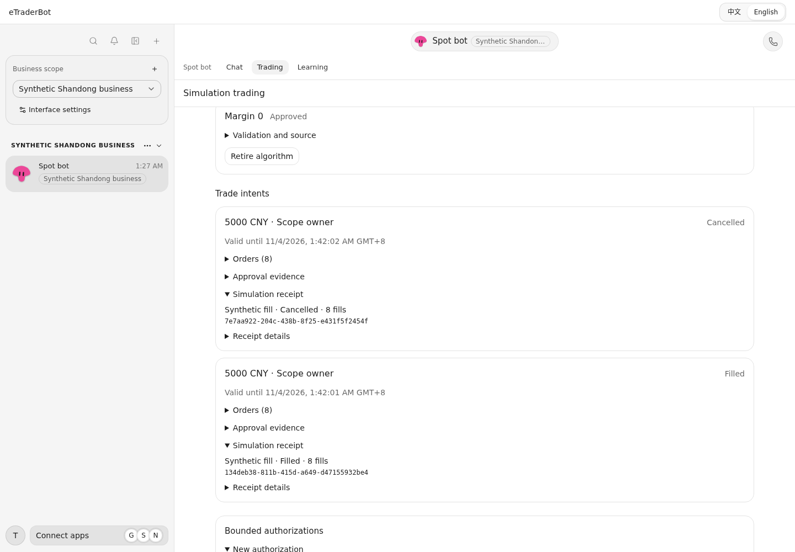

<h1 align="center">
  
</h1>

Independent developer working on AI agents, AI automation design, and video generation.

Examples include simulation, knowledge retrieval, and scientific animation.

<a href="https://junshu-sha.pages.dev">Personal website · junshu-sha.pages.dev</a>

  

## Selected projects

### [eTraderBot](https://github.com/ShaySha-PRa/eTraderBot)

A Rakazo-based V1 power-trading simulation on synthetic data. Specialized bots prepare decisions, and human approval is required before simulated execution. Company data adapters and live trading are not connected.

  

<table>
  <tr>
    <td width="50%" valign="top">
      
      <h3><a href="https://github.com/ShaySha-PRa/my-company-brain">My Company Brain</a></h3>
      
Historical prototype. No longer actively developed.

      
A team knowledge base with separate document and graph retrieval pipelines. Status snapshot 2026&#8209;08&#8209;16.

      <a href="https://github.com/ShaySha-PRa/my-company-brain/blob/main/docs/CURRENT_STATUS.md">Status snapshot →</a>
    </td>
    <td width="50%" valign="top">
      
      <h3><a href="https://github.com/ShaySha-PRa/Manim_project">Manim Workbench</a></h3>
      
A local workbench for scientific animations from prompts and data, with structured plans and sandboxed rendering.

      <a href="https://github.com/ShaySha-PRa/Manim_project/blob/main/docs/assets/formula-derivation-demo.mp4">Demo video →</a>
    </td>
  </tr>
</table>

[All repositories →](https://github.com/ShaySha-PRa?tab=repositories)
