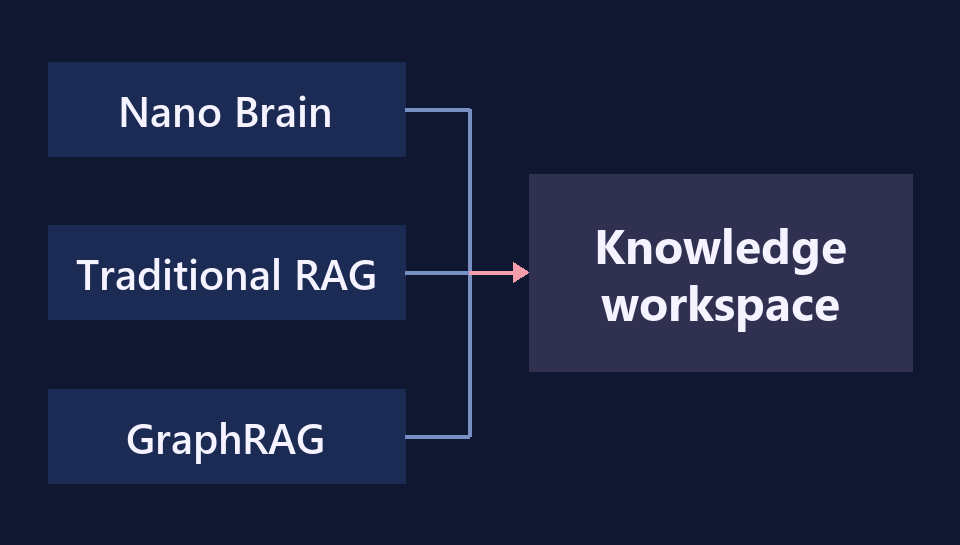
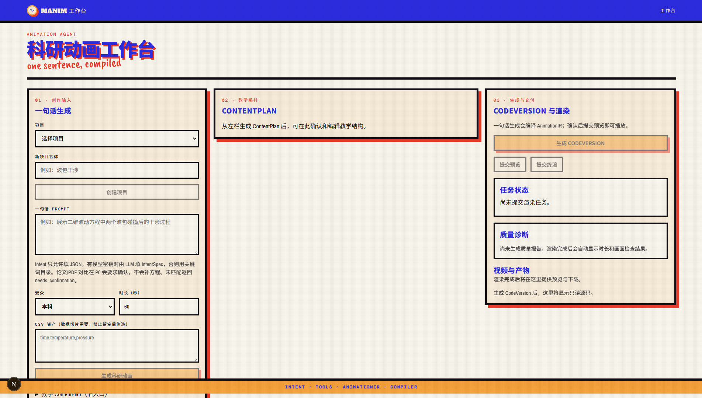

<h1 align="center">
  
</h1>

I build AI tools for simulation, knowledge retrieval, and scientific visualization.

  

## Selected projects

### [eTraderBot](https://github.com/ShaySha-PRa/eTraderBot)

A Rakazo-based electricity trading simulator with specialized bots and human approval.

  

<table>
  <tr>
    <td width="50%" valign="top">
      
      <h3><a href="https://github.com/ShaySha-PRa/my-company-brain">My Company Brain</a></h3>
      
A team knowledge-base prototype with separate document and graph retrieval pipelines.

      <a href="https://github.com/ShaySha-PRa/my-company-brain/blob/main/docs/CURRENT_STATUS.md">Project status →</a>
    </td>
    <td width="50%" valign="top">
      
      <h3><a href="https://github.com/ShaySha-PRa/Manim_project">Manim Workbench</a></h3>
      
Scientific animations from prompts and data, with structured plans and sandboxed rendering.

      <a href="https://github.com/ShaySha-PRa/Manim_project/blob/main/docs/assets/formula-derivation-demo.mp4">Demo video →</a>
    </td>
  </tr>
</table>

[All repositories →](https://github.com/ShaySha-PRa?tab=repositories)
